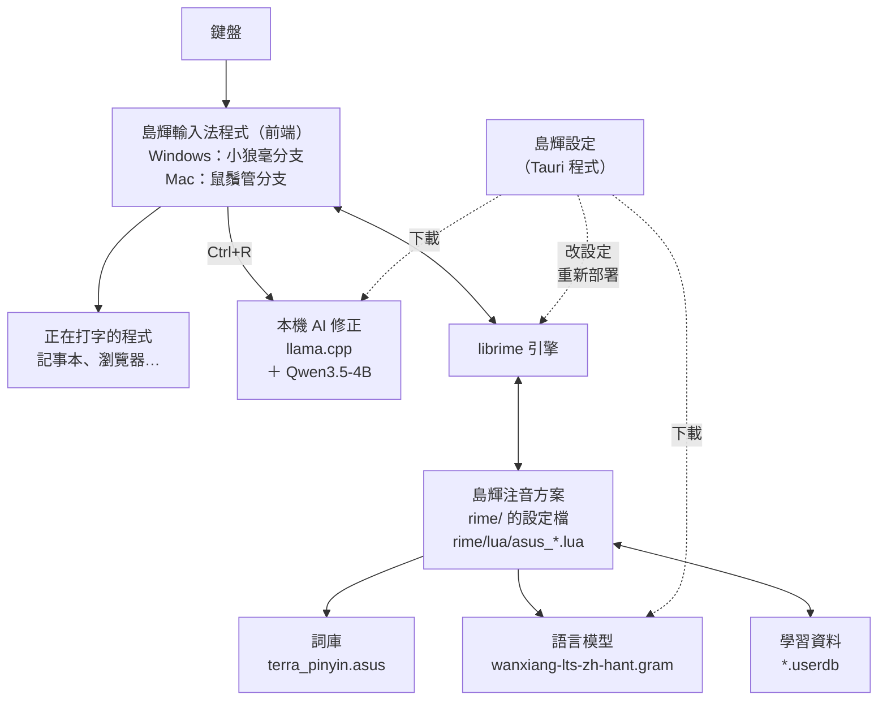
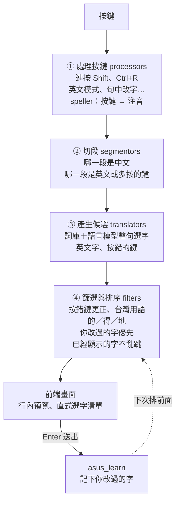
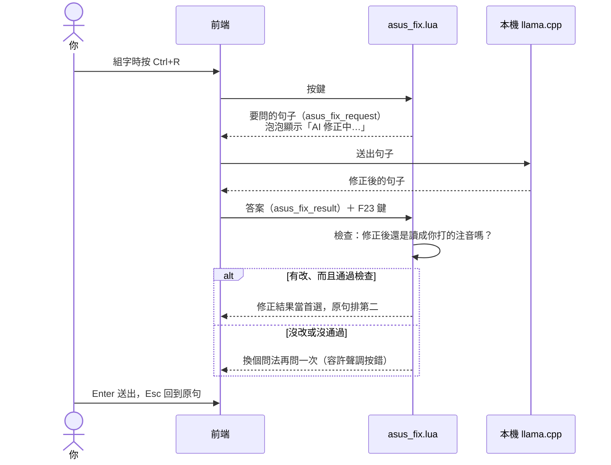
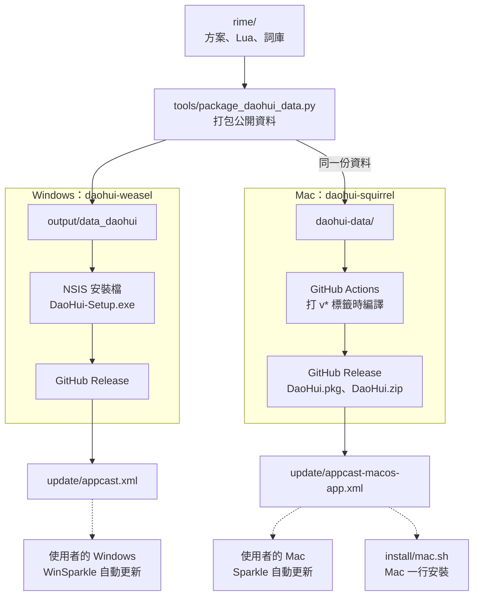
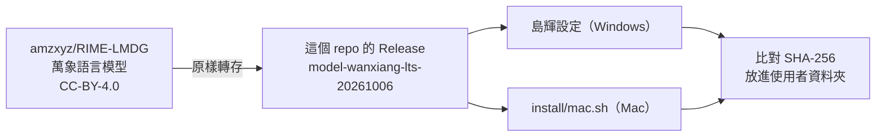
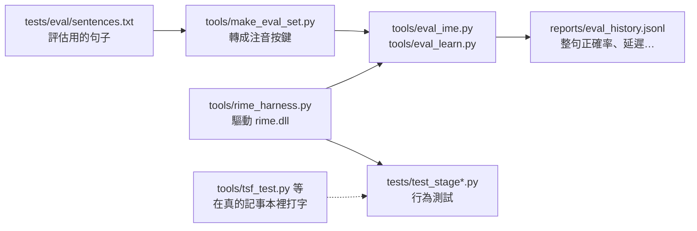

# 島輝的架構

島輝由三個 repo 組成，在你的電腦上分成「輸入法程式」和「島輝注音方案」兩層。這一頁用圖說明各部分怎麼接在一起、一個按鍵經過哪些步驟、AI 修正怎麼運作，以及新版本怎麼送到使用者手上。

- [全貌](#全貌)
- [一個按鍵經過的步驟](#一個按鍵經過的步驟)
- [AI 修正（Ctrl+R）](#ai-修正ctrlr)
- [發佈與更新](#發佈與更新)
- [測試與評估](#測試與評估)
- [三個 repo](#三個-repo)
- [檔案放在哪裡](#檔案放在哪裡)

## 全貌

- **前端**負責和作業系統打交道：收按鍵、畫行內預覽和直式選字清單、把字送進目前的程式、在背景自動更新。Windows 版和 Mac 版分別是小狼毫和鼠鬚管的改名分支。
- **librime** 是 Rime 的輸入法引擎，兩個系統共用。它依照方案設定，把按鍵變成候選字。
- **島輝注音方案**是這個 repo 的 `rime/`：大千注音鍵盤、詞庫、語言模型設定，以及 20 多個 Lua 模組（自動更正、中英混打、句中改字、自我學習…）。Windows 和 Mac 用的是同一份。
- **語言模型**讓整句選字更準，約 410 MB，所以不包在安裝檔裡，第一次使用時下載。
- 打的字、學到的詞都只在你的電腦上。只有下載、檢查更新，以及你自己設定的同步資料夾（Google Drive 等，用來在多台電腦之間同步學習資料，預設關閉）會用到網路。

## 一個按鍵經過的步驟

librime 把每個按鍵依序交給四個階段。下圖是整個流程，表格列出島輝在每個階段加上的 Lua 模組（完整順序在 `rime/asus_zhuyin.schema.yaml` 的 `engine:`）。

| 階段 | 島輝的 Lua 模組（`rime/lua/`） | 做什麼 |
|---|---|---|
| ① processors | `asus_shift` | 連按兩下 Shift 切中英（排第一，才看得到每一個按鍵） |
| | `asus_fix` | Ctrl+R AI 修正 |
| | `asus_learn` | Shift+Del 忘記學錯的字；送出時學習 |
| | `asus_english`、`asus_email` | 英文模式的補完與拼字更正、email 提示 |
| | `asus_quick`、`asus_tab`、`asus_predict` | Tab：數字的各種寫法、中英互換、下一個詞 |
| | `asus_symbols` | 符號鍵盤、Ctrl+標點 |
| | `asus_edit` | ←／→ 游標，句中換字、刪字、插字 |
| | `asus_keys` | Ctrl+Space、空白鍵、Backspace、清單裡的按鍵 |
| ② segmentors | `asus_lang` | 分出中文、英文、多按的鍵 |
| ③ translators | `script_translator`（Rime 內建） | 詞庫 ＋ 語言模型，整句選字 |
| | `asus_typo` | 拼不成注音的按鍵（多按、少按） |
| | `asus_lang`、`asus_shortcuts`、`asus_symbols` | 英文字、自訂縮寫、符號 |
| | `asus_edit` | 游標前已經改好的字固定不動 |
| ④ filters | `asus_typo` | 按到旁邊的鍵（ㄈ→ㄌ），用整句的分數判斷 |
| | `asus_tw` | 台灣用語：宕機→當機、坐標→座標 |
| | `asus_grammar` | 的／得／地、在／再 |
| | `asus_learn` | 你改過的字詞排前面 |
| | `asus_lang`（numbers、digits、steady） | 數字和注音混打、已經顯示的字不亂跳 |
| | `asus_quick` | 打開清單時的日期、數字寫法 |
| | `asus_edit`、`asus_compact` | 游標後的字不變、精簡的行內預覽 |

按 Enter 送出時，`asus_learn` 會比對你送出的字和島輝原本猜的字，把改過的地方記進學習資料，下次在別的句子裡也會用你選的。

## AI 修正（Ctrl+R）

Lua 不能連網路，所以由前端代為詢問本機的模型。模型是 llama.cpp 的 llama-server 加上 Qwen3.5-4B，只在 `127.0.0.1` 上聽，文字不會離開這台電腦；第一次按 Ctrl+R 時啟動，閒置一陣子就自動關掉，把記憶體還回來。

## 發佈與更新

方案、Lua 和詞庫只在這個 repo 改，打包後分別送進 Windows 和 Mac 的程式。使用者的島輝在背景讀更新資訊（appcast），有新版就自己下載安裝。

語言模型不經過上面的流程，單獨放在這個 repo 的 Release：

- Windows 有新版時會跳出通知，按「安裝更新」就會安靜裝好，不會再問任何問題；Mac 在背景下載，等你沒有打字的時候換成新版。
- 語言模型放在我們自己的 Release，是因為上游在 2026-10-12 原地換掉了 LTS 檔案。島輝用的是調校和測試過的 2026-10-06 版，下載後一律比對 SHA-256。
- `install-mac.yml` 會在 GitHub 的 Mac 上實際跑 `install/mac.sh`：安裝、再跑一次、移除，確認每一步都對。

## 測試與評估

改動都先在 `.harness/` 的複本上用 Python 直接驅動 `rime.dll` 量測，不碰正在使用的設定。

## 三個 repo

| repo | 內容 | 給誰 |
|---|---|---|
| [rime-asus-zhuyin](https://github.com/TimLin-1231/rime-asus-zhuyin)（這裡） | 島輝注音方案（`rime/`）、評估工具、島輝設定（`app/`）、寫作小幫手（`assist/`）、Mac 一行安裝、更新資訊 | 所有人：從這裡開始 |
| [daohui-weasel](https://github.com/TimLin-1231/daohui-weasel) | Windows 輸入法程式（小狼毫 0.17.4 的分支）、NSIS 安裝檔 | Windows 版的下載 |
| [daohui-squirrel](https://github.com/TimLin-1231/daohui-squirrel) | Mac 輸入法程式（鼠鬚管 1.1.2 的分支）、自動編譯 | Mac 版的下載 |

## 檔案放在哪裡

| | Windows | Mac |
|---|---|---|
| 輸入法程式 | `C:\Program Files\DaoHui` | `~/Library/Input Methods/DaoHui.app` |
| 學習資料、設定、語言模型 | `%APPDATA%\DaoHui` | `~/Library/DaoHui` |
| AI 修正的模型 | `%USERPROFILE%\.daohui\ai` | `~/Library/DaoHui/ai` |
| 記錄檔（log） | `%TEMP%\rime.daohui` | `$TMPDIR/rime.daohui` |

移除島輝時，學習資料、設定和語言模型會留下來，重新安裝時自動接著用。
