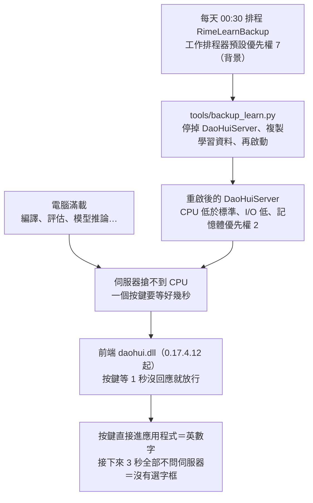

# 島輝專案流程檢討與「高負載時打出英數字」調查（2026-11-16）

這份文件回答六件事：輸入法在高負載時的問題、額度與時間花在哪裡、流程哪裡讓 AI 做不好、既有檢查實測後值不值得信、可以照做的修改步驟、以及為什麼會變成這樣和以後怎麼防止。

所有數字都是這次重新量測或重新執行得到的，沒有引用舊文件裡的「已完成」「測試通過」。原始證據放在 `D:\.rime-harness\audit-20261115\`（不在 Google Drive 備份範圍內）。這次檢討沒有改動專案裡任何既有檔案，只新增了這一份文件。

- [零、先講結論](#零先講結論)
- [一、高負載時打出英數字、沒有選字框](#一高負載時打出英數字沒有選字框)
- [二、額度和時間花在哪裡](#二額度和時間花在哪裡)
- [三、各流程原本要什麼，哪些設計讓 AI 做不好](#三各流程原本要什麼哪些設計讓-ai-做不好)
- [四、實測既有的檢查：哪些是真的，哪些是裝飾](#四實測既有的檢查哪些是真的哪些是裝飾)
- [五、可以照做的修改步驟](#五可以照做的修改步驟)
- [六、為什麼會爛，以後怎麼不再爛回去](#六為什麼會爛以後怎麼不再爛回去)
- [附錄：證據位置與沒查到的事](#附錄證據位置與沒查到的事)

## 零、先講結論

1. **高負載打出英數字的原因找到了，而且重現了。** 每天 00:30 的學習資料備份排程會把輸入法伺服器（DaoHuiServer）停掉再啟動，重啟後的伺服器繼承了排程工作的「背景」優先權：CPU 低於標準、磁碟 I/O 低、記憶體優先權 2（正常是 5）。電腦一忙，伺服器就搶不到 CPU；前端等超過 1 秒就把按鍵直接交給應用程式，並在接下來 3 秒內完全不問伺服器。注音鍵本來就是英文字母和數字，所以你看到的是一串英數字，也不會有選字框。
2. **額度的 3/4 花在「重讀舊對話」，不是花在做事。** 4,934 次模型呼叫裡，一半以上是在 30 萬 token 以上的對話裡發出的。只要每個對話不超過 15 萬 token，同樣的工作大約省 46%。
3. **「測試通過」只證明了 librime 加 Lua 這一層。** 你回報過的 17 個問題裡有 12 個發生在測試碰不到的地方（Windows 前端、行程間通訊、安裝程式、Mac、排程）。此外，評估工具在 Lua 整個壞掉時仍然回報成功。
4. **沒人看的自動化壞了很久。** 11 月 4 日到 12 日，備份連續失敗 104 次，每兩小時把輸入法停掉約 5 秒，其中 8 天沒有任何一份完好的備份，沒有任何通知。
5. **實測還找到一個現在就存在的錯誤**：在你使用的「先顯示按鍵」模式下，多按兩個鍵再用 Backspace 刪掉，整句會變回英數字，按 Enter 就把英數字送出去。這個錯誤和負載無關。

## 一、高負載時打出英數字、沒有選字框

### 原因

問題由兩個各自「已完成」的改動疊起來：



- 排程這一半是 10 月 10 日（階段 9）和 10 月 27 日做的：備份時必須停掉伺服器，因為它鎖住了學習資料庫。
- 逾時這一半是 10 月 31 日做的：當時工作列和 Chrome 會卡住，修法是讓前端最多等 1 秒，逾時就把按鍵交給應用程式。程式裡的註解寫明了這個行為：「A request that gets no answer in time counts as failed: a key goes to the application」。

### 證據

| 項目 | 量到的結果 | 怎麼量的 |
|---|---|---|
| 正在執行的伺服器 | CPU `BELOW_NORMAL`、I/O `Low`、記憶體優先權 `2`；啟動時間 00:30:03，與備份紀錄同一秒。隔天再量仍然如此（每天都會重來） | 讀取行程資訊（`prio.py`，唯讀） |
| 對照：檔案總管 | CPU `NORMAL`、I/O `Normal`、記憶體優先權 `5` | 同上 |
| 兩個排程的優先權 | `RimeLearnBackup` 和 `DaoHuiSync` 都是 7。微軟文件：預設值 7 用於背景工作，對應 `BELOW_NORMAL_PRIORITY_CLASS`；4 到 6 用於互動式工作 | `Get-ScheduledTask` |
| 優先權會不會繼承 | 會。從「像排程那樣」的父行程直接啟動子行程，子行程是 `BELOW_NORMAL / Low / 2`。只加「標準優先權」旗標，CPU 會恢復，但 I/O 和記憶體仍是低的 | 用不相干的假子行程實驗（`inherit_test.py`） |
| 伺服器自己有沒有設定優先權 | 沒有。整個 `D:\src\daohui` 找不到任何設定優先權的程式碼 | 全文搜尋 |
| 前端逾時 | 按鍵 1000 毫秒、焦點類 200 毫秒；按鍵逾時後所有請求跳過 3000 毫秒 | `WeaselIPC/WeaselClientImpl.cpp` 第 13 到 20 行、第 244 到 262 行 |
| 逾時的按鍵去哪裡 | `*pfEaten = FALSE`，也就是交給應用程式 | `WeaselTSF/KeyEventSink.cpp` 第 131 到 133 行、第 150 行 |

重現實驗（引擎和負載都綁在 4 顆邏輯核心上，不影響你正在用的輸入法）：

| 引擎的優先權 | 同 4 顆核心上的滿載執行緒 | 每鍵平均 | 最慢 | 超過 1 秒的按鍵 |
|---|---:|---:|---:|---:|
| 標準 | 0 | 13 毫秒 | 89 毫秒 | 0 / 909 |
| 標準 | 4 | 12 毫秒 | 46 毫秒 | 0 / 909 |
| 標準 | 8 | 16 毫秒 | 70 毫秒 | 0 / 909 |
| 排程繼承來的 | 0 | 23 毫秒 | 1,341 毫秒 | 1 / 909 |
| 排程繼承來的 | 4 | 638 毫秒 | 9,800 毫秒 | 18 / 106（17%） |
| 排程繼承來的 | 8 | 1,023 毫秒 | 5,906 毫秒 | 13 / 62（21%） |

另一個代理獨立重做了這個實驗，結果一致（標準優先權 597 鍵全部在 43 毫秒內；背景優先權 42 鍵裡 8 鍵超過 1 秒，最慢 23.7 秒）。

**沒有驗證到的一段**：沒有在真的視窗裡打字看按鍵漏出去（那需要佔用你的鍵盤）。這一段的依據是前端原始碼、量到的優先權、沙箱重現，以及伺服器紀錄裡一筆 1,015 毫秒的按鍵。前端自己不記錄逾時，所以實際發生過幾次無從得知。

**同樣會打出英數字、但和負載無關的另外兩條路**（方便你分辨）：

- 先顯示按鍵模式的 Backspace 錯誤（見第四節）：症狀是刪掉多按的鍵之後整句變回英數字，不會自己恢復。
- 誤觸連按兩下 Shift 切到英文模式：語言列會顯示英文，直到再切回來。

負載造成的那一種會在幾秒後自己恢復，而且伴隨明顯的卡頓。

### 現在就能做的處置

從開始功能表執行「島輝輸入法 → 島輝算法服務」。這會由檔案總管以標準優先權重新啟動伺服器。**效果只到下一次 00:30**，之後排程又會把它變回背景優先權，所以還是要做下面的修正。

確認方式（唯讀，可隨時執行）：

```bash
python "C:\Users\User\AppData\Local\Temp\claude\9e0a2d41513ffaf2\a3b664e8-01c6-40cd-b5b6-4cca2831355d\scratchpad\prio.py" DaoHuiServer.exe
```

應該印出 `cpu=NORMAL io=Normal page=5`。這支腳本在暫存資料夾裡，重開機後可能消失；修正步驟 A4 會把它收進專案。

### 永久修正

步驟寫在[第五節 A 組](#a-組輸入法的實際問題)。重點有三層，一層擋一層：

1. 排程本身用標準優先權（`<Priority>4</Priority>`）。
2. 備份腳本啟動伺服器後，把它的三種優先權明確設回正常。
3. 伺服器啟動時自己把優先權設回正常，這樣不管誰啟動它都不會出事。

前端「逾時就把按鍵放行」的行為要不要改，是需要你決定的取捨，寫在 A5。

## 二、額度和時間花在哪裡

### 總量

統計範圍是 `C:\Users\User\.claude\projects\D--Document----\` 裡這次檢討之前的 44 個 JSONL 檔（10 個主對話和 17 個子代理；分支對話重複的部分已去掉）。

- 模型呼叫 4,934 次，輸出 589 萬 token，從快取重讀 **17.95 億** token。
- 換算成「等值輸入 token」共 2.42 億（輸入算 1、寫入快取 1.25、讀取快取 0.1、輸出 5）。這是相對比例，不是帳單金額。
- 有動作的時間約 67 小時；其中等待指令執行約 16 小時。

### 最大的一筆：對話太長

每一次呼叫都要把整段對話重讀一遍。對話 80 萬 token 時，執行一次 `git status` 的成本約等於 8 萬 token。

| 發出呼叫時的對話長度 | 呼叫次數 | 佔總成本 |
|---|---:|---:|
| 15 萬以下 | 805（16%） | 7% |
| 15 萬到 30 萬 | 1,546（31%） | 21% |
| 30 萬到 50 萬 | 1,337（27%） | 27% |
| 50 萬到 70 萬 | 634（13%） | 19% |
| 70 萬以上 | 612（12%） | 25% |

- 呼叫時對話長度的中位數是 31 萬 token。
- 輸出（真正寫出來的東西）只佔成本的 12%；重讀對話佔約 75%。
- 如果每個對話不超過 15 萬 token，總成本約為實際的 54%；不超過 20 萬是 62%。
- 單一最貴的對話是 10 月 25 日到 11 月 3 日那一個：1,855 次呼叫、88 個提示、最長 96.5 萬 token、壓縮 14 次。它加上它派出的子代理佔全部成本的 62%。在這個對話裡，改一個空格的錯字花了約 19.5 萬等值 token。
- 這個對話裡約 29 個人工提示中有 13 個是點模型自己提供的「下一步」按鈕。流程本身鼓勵在同一個對話裡一直做下去。

### 其他看得見的浪費

每一項都附了次數，方便你判斷大小。

| 浪費 | 次數與時間 | 流程上的原因 |
|---|---|---|
| 手打迴圈跑測試 | 183 次測試呼叫；13 次全套，用了 11 種不同寫法，7 次沒有逾時 | 沒有測試執行器，每次都重新發明 |
| 跑完整評估 | 約 212 次 `eval_ime`，其中約 170 次沒指定範圍（全部 44 組，7 到 22 分鐘）；等待 5 小時 | 預設就是全部跑；沒有「只跑相關幾組」的捷徑 |
| 在前景等待 | `sleep` 輪詢 58 次，等了 2.1 小時（當時對話最長到 88.7 萬 token） | 沒有用背景執行加通知 |
| 一次失控的評估 | 跑了 63 小時，寫出 563 GB 紀錄，把 C 槽塞滿 | 沒有逾時、沒有人看 |
| heredoc 寫 Python 弄壞反斜線 | 289 次用 heredoc；教訓在日記裡寫了 6 次（10 月 10 日到 30 日），之後照犯 | 規則只是日記裡的一句話，沒有機制擋 |
| 維護日記 | 編輯 58 次，平均在 46.2 萬 token 的對話裡做；讀 12 次共 36.6 萬字元 | 唯一的交接文件是一份 73 KB 的流水帳，而且都在對話最貴的時候寫 |
| 計畫與收尾工具 | 245 次呼叫，佔成本 4% | 在長對話裡，每次例行呼叫都很貴 |
| 子代理 | 17 個，1,888 次工具呼叫，佔成本 20%；每個一開始就帶 9 到 11 萬 token | 交辦的是「整個產品」而不是小任務；每個代理都重新摸索環境 |
| 子代理摸索環境 | 33 次被 worktree 防護擋下、13 次計畫工具被拒、手動複製 400 到 490 MB 資料 | 沒有一份短的規則檔告訴它們環境長怎樣 |
| 做了又丟 | 兩整套圖示（161 次呼叫中約 110 次）在問你喜好之前就做完，然後丟掉 | 涉及品味的事沒有先問 |
| 發佈 | 4 天內 12 次以上公開發佈，每次手打 10 到 30 個指令 | 發佈步驟只存在日記裡，沒有腳本 |
| Antigravity 多代理 | 44 個代理、186 個檔案、29 次審查判定，只改了約 128 行；功能在你手上第一下就壞；下一個對話 4 分鐘修好 | 27 個驗證代理用的是同一種證據 |

九個閱讀代理逐段讀完對話紀錄，一共標出 328 段浪費、113 處「說完成但後來證明不是」、110 則你表達不滿或重複要求的訊息。完整清單在 `collected\w1_full.md`。

## 三、各流程原本要什麼，哪些設計讓 AI 做不好

| 流程 | 原本要的成果 | 讓 AI 做不好的設計 |
|---|---|---|
| 專案規則與交接 | 新對話一開始就知道該知道的事 | 沒有 `CLAUDE.md`。唯一的記憶是 73 KB、90 行的日記，最新也最長的內容在最後 30 行；讀檔工具超過 25,000 token 會截斷，所以預設只讀到 10 月 17 日。「`rime/` 就是正在用的輸入法資料夾」「不要選小狼毫」「三個 repo 怎麼發佈」全在被截掉的那一段 |
| 分階段、先計畫再同意 | 你掌握每一步 | 只在日記第 11 行寫了一句「5 個階段」，階段 5 之後沒更新。你的同意散落在 19 處「approved」和 10 處「ask first」裡，有些寫明「只限這一次」，沒有清單可查哪些還有效 |
| 測試 | 改動不會弄壞既有功能 | 沒有執行器、沒有 CI、沒有任何一處列出「全部測試」是哪些。README 列了 23 個檔，實際追蹤 34 個、磁碟上 49 個。歷次「全部 24／26／31 個通過」和當時的檔案數（27／29／32）都對不上 |
| 評估 | 用數字判斷有沒有變好 | 每組只有 25 到 100 句，一句就是 1 到 4 個百分點，很多決定建立在 1 到 3 句的差異上。「保留測試集」是寫功能的同一個對話自己出的題，而且被評了最多 44 次 |
| 測試替身（harness） | 不碰正在用的輸入法就能驗證 | 它只驅動 `rime.dll`，沒有 Windows 前端、沒有行程間通訊、沒有視窗、沒有時間因素。它還故意略過你的個人設定檔，所以測的是預設模式，不是你實際在用的模式 |
| 正式環境 | 改好的東西到你手上 | 專案的 `rime/` 就是安裝好的輸入法正在讀的資料夾。半成品在你按「重新部署」時就上線；評估時曾在這個資料夾裡替換詞典，只好請你那段時間不要部署 |
| worktree 與子代理 | 平行做事互不干擾 | 規則一邊說大檔案不可放在 `D:\Document`（Google Drive 會出事），另一邊的做法是把 410 MB 的語言模型複製進每個 worktree，而 worktree 就在 `D:\Document` 底下。11 個 worktree 至今沒清，佔 3.18 GB |
| Windows 與 Mac 發佈 | 你和其他使用者拿到新版 | 步驟分散在日記的 5 個段落、4 個不同日期。版本號有時是 commit 數、有時要手動覆寫。Windows 那個 repo 的 CI 最近 14 次全部是「已取消」。`gh` 目前登入的是另一個帳號 |
| 備份與同步 | 學習資料不會丟 | 結果只寫進一個紀錄檔，失敗時沒有任何人會知道。工作排程器的歷程記錄是關的 |
| 真視窗測試 | 確認在真的程式裡能用 | 需要佔用鍵盤，所以很少跑；只測記事本，而你的問題都出在 Chrome 和 Claude 桌面版 |
| Antigravity 多代理流程 | 用多重審查保證品質 | 所有審查者讀同一份需求、用同一個測試替身。沒有任何一個代理在真視窗打過字、問過你，或試過需求範例以外的按鍵。需求表裡的注音符號本身就寫錯了（`s` 寫成ㄙ，實際是ㄋ），「已驗證」的報告照抄了錯的 |

貫穿這些流程的共同點：**「完成」沒有定義**。同一個詞有時指測試替身通過、有時指 CI 通過、有時指你試過。因為只有第一種能自己做，模型就一直用第一種。

## 四、實測既有的檢查：哪些是真的，哪些是裝飾

### 可以信的

| 檢查 | 實測結果 |
|---|---|
| 34 個追蹤中的測試檔 | 今天全部通過：1,082 項檢查、0 失敗、5 到 6 分鐘。除了 `test_stage16.py`（見下表）以外，重跑 4 次結果相同。整個元件被拿掉時，測試幾乎都會發現（一組 44 處破壞抓到 41 處）；但細部邏輯改錯時只抓到約七成（見下方「變異測試」） |
| 評估的正確率 | 完全可重現：44 組 97 個數字與 10 月 31 日的紀錄一模一樣，重跑 4 次相同。拿掉錯字更正，錯字組掉 25 到 28 點；拿掉語言模型，保留組掉 10 到 15 點 |
| 最新一份備份 | 完好。用獨立寫的 LevelDB 讀取器逐塊驗證：29 個雜湊全對、36,937 筆學習資料與清單相符 |
| 發佈檔案 | 三份更新資訊裡的大小和 SHA-256 都和 GitHub 上的檔案相符；`DaoHui-Setup.exe` 連結有效；語言模型的三處常數一致 |

### 不能信的

| 檢查 | 實測發現 | 嚴重性 |
|---|---|---|
| 評估「跑完沒報錯」 | 讓一個 Lua 模組載入失敗，評估照樣結束碼 0、沒有任何錯誤訊息，只是每一組都印 0.0%。讓一個篩選器在輸出後才出錯（紀錄裡 6,353 行錯誤），結果與正常完全相同。錯誤只寫進暫存紀錄檔，下次執行就刪掉 | 很高 |
| 「測試通過」代表你用的模式沒問題 | 只有 13% 的檢查（1,082 項中的 136 項，34 個檔中的 3 個）跑在你實際使用的先顯示按鍵模式 | 高 |
| 延遲檢查（每鍵小於 30 毫秒） | 每個按鍵故意加 20 毫秒（慢 5 到 10 倍）仍然全部通過；加到 100 毫秒才會失敗 | 高 |
| `tools/latency.py` | 可重現（平均 5.1 毫秒），但它在行程內、標準優先權下量，看不到伺服器、前端和負載。對你這次的問題完全沒有鑑別力 | 高 |
| 伺服器慢速紀錄 | 它從「讀到請求之後」才開始計時，搶不到 CPU 的等待時間不算在內；前端逾時也不記錄。所以它剛好漏掉高負載這一種情況。16 天裡只記到 1 筆超過 1 秒的按鍵 | 高 |
| 備份「每天一份、已驗證」 | 11 月 4 日到 12 日連續失敗 104 次。原因是舊的小狼毫伺服器在 11 月 3 日被啟動，佔住了同一個資料夾的詞庫，直到 11 月 12 日重開機才結束。腳本只會停掉島輝，不知道還有另一個。失敗後每兩小時重試一次，每次把輸入法停掉約 5 秒。8 天沒有完好的備份；詞庫紀錄裡出現「Some data may have been lost」 | 很高 |
| 備份「保留 14 天，舊的刪除」 | 資料夾從來沒刪掉（唯讀屬性讓刪除失敗），現在有 139 個，其中 71 個是空殼。紀錄裡的「removed N old」是同一批空殼重複計算 | 中 |
| 備份還原 | 13 個情境通過 8 個。失敗的 5 個：還原中斷後留下暫存資料夾（4 個）；清單沒有雜湊時會還原出被截斷的資料表（1 個） | 中 |
| `package_daohui_data.py --check`（隱私檢查） | 故意放進個人字詞 17 種情況，只抓到 5 種。個人字詞放在 Lua 註解、Lua 資料表、新的詞典檔都過關；找不到私人清單時直接回報 ok | 高 |
| `package_daohui_data.py --smoke` | 把島輝所有的 Lua 元件從方案裡拿掉，仍然 4/4 通過，因為那四句（你好、我是…）原版 Rime 就打得出來 | 高 |
| 保留測試集「不看失敗內容」 | 唯一的機制是輸出時略過檔名含 `test` 的組。紀錄裡找得到直接讀取和編輯保留集的指令 | 中 |
| Antigravity 留下的 15 個測試檔 | 12 個通過、3 個每次都失敗。6 個「紀錄裡沒有 Lua 錯誤」的檢查找的是不存在的檔案，實驗證明在 2,619 行 Lua 錯誤下照樣通過 | 中 |
| `tests/test_stage16.py` | 電腦忙的時候會失敗（今天 11 次中 3 次）。過去的做法是重跑到通過，然後回報全部通過 | 中 |
| Windows 那個 repo 的 CI | 最近 14 次全部「已取消」，等於沒有 | 中 |
| `start_assist.bat` | 路徑裡的 `\a` 從第一次提交（10 月 11 日）起就被存成一個響鈴字元，檔案指向不存在的路徑。這正是 heredoc 弄壞反斜線的結果。README 請使用者執行這個檔 | 中 |

### 變異測試：故意把程式改錯，看測試抓不抓得到

做法：在專案的獨立複本裡，每次只改一處（條件反過來、差一、常數改錯、按鍵碼對調、拿掉一行、調換元件順序…），跑相關的測試檔；沒被抓到的就再跑全部 32 個驅動 librime 的測試檔。每次改完都還原，並用 SHA-256 確認還原成功。總共 104 處邏輯和設定的破壞、11 處基礎設施的破壞，執行測試檔 1,453 次，約 3.9 小時。

**邏輯破壞：抓到 70/102 = 68.6%**（扣掉 2 處證明不影響行為的）。

- 兩批破壞是由不同的代理各自設計的。第一批 56/75 = 74.7%，第二批只有 14/27 = 51.9%。所以前面「一組 44 處抓到 41 處」高估了測試的能力：那一組多半是「整個元件拿掉」，這種錯最容易被發現。
- 抓到的 70 處裡，56 處是由檢查那個行為的測試抓到的，13 處是碰巧被別的檢查抓到，1 處是測試程式自己當掉。
- 抽 6 處重跑（3 處抓到、3 處沒抓到），結果全部和紀錄相同。

| 模組 | 抓到／有效破壞 | 沒人驗證的行為（舉例） |
|---|---|---|
| asus_compact | 2/5 | `show_keys: false` 沒作用；長輸入只顯示最後 24 個鍵；罕用字（擴充 B 區以後）沒被藏起來 |
| asus_symbols | 2/5 | Shift+Tab 回上一個符號分類；英文後面的 `^` 變成全形 `……` |
| asus_email | 1/3 | 只打 2 個字就跳出 email 提示 |
| asus_keys | 3/6 | 數字鍵盤的 `-` 變成 `+`；`3.` Enter `5` Enter 打出「3.中」而不是 3.5 |
| asus_tw | 2/4 | 台灣用詞改寫後，原本的寫法不再是下一個候選；3 到 4 字的台灣用詞（一目了然） |
| asus_sync | 2/4 | 同步時，時間剛好等於刪除標記的項目被刪掉 |
| 方案設定 | 9/13 | 數字鍵盤的 Enter 把字清掉而不是送出；學到的更正輸給的／得／地規則 |
| 其他設定 | 3/5 | 組字中按 Caps Lock 把字清掉；個人詞庫沒匯入（150 句中錯 20 句，測試照樣全過） |
| asus_lang、asus_typo、asus_shift、asus_grammar | 9/10、4/4、3/3、3/3 | 最穩 |

其他沒被抓到的例子：12:30 顯示成「上午12:30」；接下來的詞只預測 2 個而不是 3 個；游標在最前面按 Backspace 會刪掉最後一個字；AI 修正沒回應時永遠卡在「修正中」。完整清單在 `p3\out\tables\t1_mutants.md`。

**基礎設施破壞：librime 從來不會報錯，只會寫進紀錄繼續跑。**

| 破壞 | 32 個測試檔裡仍通過的 |
|---|---:|
| 某個 Lua 模組載入時出錯、刪掉 Lua 檔、方案 YAML 格式錯誤、詞典匯入的檔案不見 | 0 到 2 |
| 處理按鍵的 Lua 每次都出錯（asus_email） | 2；其餘 30 個裡，29 個只因為「紀錄裡有 Lua 錯誤」才失敗，真正檢查到行為的只有 1 個 |
| 語言模型檔不見 | 21 |
| 預測用的資料檔不見 | 29 |
| 台灣用詞的資料檔不見 | 30 |

- 30 個測試檔都有一項「紀錄裡沒有 Lua 錯誤」的檢查，但它只看同時含有 `E` 開頭和 `lua` 字樣的行。語言模型、詞典、YAML、OpenCC 的錯誤都不算，所以在這些破壞下它照樣印 PASS。
- 整個引擎壞掉時，有 4 到 5 個測試檔是以 `IndexError` 當掉收場，而不是印出哪一項失敗。
- 跑完全部 34 個測試檔要 5 到 6 分鐘；每多一個沒被抓到的破壞，就要多花約 5 分鐘確認。

最值得補的 10 個測試，每個都有具體的按鍵和預期結果，列在[第五節 B12](#b12補上變異測試找到的缺口)。

### 實測找到的產品錯誤

**先顯示按鍵模式下，Backspace 刪到聲調鍵之後整句變回英數字。** 你的設定是這個模式（`asus_lang/raw_keys: true`）。

| 輸入 | 行內顯示 | 按 Enter 送出 | 應該是 |
|---|---|---|---|
| `su3xx`，按 2 次 Backspace | `su3` | `su3` | 你 |
| `su3cl3dc`，按 2 次 Backspace | `su3cl3` | `su3cl3` | 你好 |
| `ji3m/4xx`，按 2 次 Backspace | `ji3m/4` | `ji3m/4` | 我用 |

14 個情境中有 9 個送出錯的字；關掉這個模式則 0 個。多按一個鍵再刪一次不會出事，接著再打一個音節也會恢復。追蹤中的測試沒有一個涵蓋到；唯一會失敗的檢查在 Antigravity 留下、之後沒有任何對話執行過的檔案裡。重現腳本：`p2\scripts\repro_raw_bs2.py`。

另外，強制用這個模式跑追蹤中的測試，會發現自訂縮寫（`rime/shortcuts.txt`）不再排第一，按 Enter 也不會送出展開的內容。這是不是你要的行為，需要你決定。

## 五、可以照做的修改步驟

每一步都寫了：改哪個檔、改成什麼、怎麼確認、怎麼退回、依據的原則。A 組是輸入法現在的實際問題，B 組是流程。建議順序是 A1 到 A4（一小時內可完成、不需要重新編譯），然後 B1 到 B3，其餘依需要。

**2026-11-16 已套用 A1、A2、A4**（尚未 commit）：

- A1：`tools/backup_learn.py` 的排程加上 `<Priority>4</Priority>`，已用 `--install` 重新註冊。比對前後的排程設定，只差這一行。
- A2：新增 `tools/procprio.py`（讀寫行程的三種優先權）；`start_server()` 啟動伺服器後呼叫 `procprio.set_normal()`。`tests/test_backup.py` 加了 3 項檢查，24/24 通過。
- A4：新增 `tools/doctor.py`。分兩級：FAIL 是現在就影響打字或學習資料的問題，結束碼 1；WARN 是整理類的提醒。用假資料夾確認過，備份失敗、備份過期、部署落後都會報 FAIL。
- 正在執行的伺服器還是背景優先權：修正從下一次排程重啟（00:30）起才生效，在那之前可以從開始功能表執行「島輝算法服務」立刻恢復。

其餘步驟都還沒執行。A 組多數會動到正在使用的系統，需要你同意。

### A 組：輸入法的實際問題

**A1　備份排程改用標準優先權**

- 檔案：`tools/backup_learn.py`，`TASK_XML` 的 `<Settings>` 區塊（第 516 到 523 行）。
- 改成：在 `<Enabled>true</Enabled>` 前加一行 `<Priority>4</Priority>`。然後重新註冊排程：`C:\Users\User\anaconda3\python.exe tools\backup_learn.py --install`。
- 確認：`(Get-ScheduledTask RimeLearnBackup).Settings.Priority` 印出 4。下一次 00:30 之後用 `prio.py` 看伺服器，應為 `cpu=NORMAL io=Normal page=5`。
- 退回：`git checkout tools/backup_learn.py`，再執行一次 `--install`。
- 原則：微軟文件說明 7 和 8 是給背景工作的，4 到 6 是給互動式工作的。會重啟輸入法的工作不是背景工作。
- 還沒驗證：「優先權 4 的排程啟動的子行程三項都正常」只有文件依據，建立排程屬於系統設定，這次沒有做。所以要搭配 A2。

**A2　備份腳本啟動伺服器後，把優先權明確設回正常**

- 檔案：`tools/backup_learn.py`，`start_server()`（第 251 到 256 行）。
- 改成：`Popen` 成功後，用 `OpenProcess(PROCESS_SET_INFORMATION | PROCESS_QUERY_LIMITED_INFORMATION)` 開啟新行程，依序呼叫 `SetPriorityClass(NORMAL_PRIORITY_CLASS)`、`NtSetInformationProcess(33, 2)`（I/O 正常）、`NtSetInformationProcess(39, 5)`（記憶體優先權正常）。只加建立旗標不夠，實驗顯示那樣 I/O 和記憶體仍是低的。可直接沿用 `inherit_test.py` 裡的 `set_state()`。
- 確認：執行 `inherit_test.py`，第 5 列（父行程從外面修好子行程）應為 `NORMAL / Normal / 5`。在 `tests/test_backup.py` 加一項：從低優先權的父行程呼叫 `start_server()` 啟動假程式，量到的三項都正常。
- 退回：`git revert`。
- 原則：不要依賴呼叫者的狀態；自己需要什麼就自己設定。

**A3　伺服器啟動時自己設定優先權（需要重新編譯和發佈）**

- 檔案：`D:\src\daohui\WeaselServer\WeaselServer.cpp`，`_tWinMain` 開頭（第 25 行之前）。
- 改成：`SetPriorityClass(GetCurrentProcess(), NORMAL_PRIORITY_CLASS)`；`SetProcessInformation(..., ProcessMemoryPriority, MEMORY_PRIORITY_NORMAL)`；`NtSetInformationProcess(..., ProcessIoPriority, IoPriorityNormal)`。實驗第 4 列證明行程可以自己把這三項調回正常，不需要特殊權限。
- 確認：把編譯出的伺服器從低優先權的父行程啟動（不要動到安裝的那一份），用 `prio.py` 量。發佈後，每天 00:30 之後量一次，連續三天。
- 退回：裝回前一版安裝檔。
- 原則：輸入法伺服器是互動路徑上的行程，它的回應時間不應該取決於誰啟動它。同步排程（`app/daohui-settings/src-tauri/src/autosync.rs` 第 93 行，也是 `<Priority>7</Priority>`）順便改成 4。

**A4　加一支健康檢查腳本，讓這類問題看得見**

- 檔案：新增 `tools/doctor.py`（唯讀，不改任何東西）。
- 已實作（見上方）。原始規劃的檢查項目：伺服器三項優先權是否正常；是否同時有兩個 Rime 伺服器（島輝和小狼毫）在跑；備份紀錄最後一筆是否為 ok、距今是否少於 26 小時；慢速紀錄最近 24 小時超過 500 毫秒的筆數；`git worktree list` 是否只有主目錄；未追蹤檔案數；`WEASEL_TSF_LOG` 是否還設著；`gh` 目前帳號是否為 `TimLin-1231`；部署時間是否晚於 `rime/` 最新的修改。任何一項不對就結束碼 1 並印出該怎麼辦。
- 確認：今天執行應該失敗在「伺服器優先權」「worktree」「未追蹤檔案」「`WEASEL_TSF_LOG`」「`gh` 帳號」這幾項；每修好一項就少一項。
- 退回：刪掉檔案。
- 原則：沒有人會看到失敗訊號的檢查，不算檢查。

**A5　前端逾時之後怎麼辦（需要你決定，要在真視窗測試）**

- 檔案：`D:\src\daohui\WeaselIPC\WeaselClientImpl.cpp`、`WeaselTSF\KeyEventSink.cpp`。
- 第一步，不改行為只加紀錄：每次逾時在 `%TEMP%\rime.daohui\DaoHuiClient.timeouts.log` 寫一行（時間、請求種類、程式名稱）。伺服器的慢速紀錄也從「請求送達」開始計時。這一步沒有爭議，而且做完才知道 A1 到 A3 之後還剩多少次逾時。
- 第二步，三個選項：

| 選項 | 做法 | 好處 | 代價 |
|---|---|---|---|
| 甲（建議） | 組字進行中時，逾時的按鍵吞掉而不放行；3 秒全面暫停只套用在焦點類請求 | 不會再有英數字混進文字 | 極端情況下一個按鍵會不見；應用程式每鍵最多卡 1 秒 |
| 乙 | 維持現狀，只靠 A1 到 A3 降低發生率 | 不用改前端 | 只要伺服器因為任何原因慢，症狀就回來 |
| 丙 | 逾時的按鍵先留著，伺服器恢復後補送 | 不掉鍵也不漏鍵 | 最複雜，前端要多一個佇列，風險最高 |

- 確認：用一個故意延遲回應的假伺服器（10 月 31 日做過一個 `pipetest`）測前端：組字中逾時，應用程式收到的字元數為 0。再做一次真視窗測試：背景跑滿 CPU，在記事本打 20 句，送出的文字裡沒有注音鍵的英數字。
- 退回：前一版安裝檔。
- 原則：失敗時的行為要選「看得出來壞了」而不是「看起來正常但內容是錯的」。

**A6　備份腳本的三個缺陷**

- 檔案：`tools/backup_learn.py`。
- 改成：(1) `weasel_server()` 目前只回傳第一個在跑的伺服器；改成停掉 `SERVERS` 裡所有在跑的，並在無法複製時指出是哪個行程佔住。(2) 備份失敗後，當天不要再停伺服器重試；改成寫一個看得見的標記（例如在 `backups/learn/` 放 `LAST_BACKUP_FAILED.txt`，並由 `doctor.py` 和島輝設定讀它）。(3) `prune()` 和 `restore()` 刪資料夾前先清掉唯讀屬性，並且只計算真的消失的資料夾；`restore()` 拒絕沒有雜湊的清單。
- 確認：在暫存目錄的複本上鎖住 `terra_pinyin.userdb\LOCK` 再執行，應產生失敗標記而且只停伺服器一次；`p4\restore_test.py` 從 8/13 變成 13/13；`p4\rmtree_ro.py` 的唯讀情境不留資料夾。一次性清理：刪掉 71 個空殼和 `rime\*.userdb.restore-20261025-125706` 三個空資料夾（後者要在伺服器停止時做）。
- 退回：`git revert`。
- 原則：無人值守的工作，失敗時要比成功時更吵。

**A7　移除舊的小狼毫（先做 A7a 再做 A7b）**

- A7a 檔案：`tools/rime_harness.py`，`weasel_root()`（第 218 行）。改成先讀 `HKLM\SOFTWARE\WOW6432Node\DaoHui`，找不到才讀 `Rime\Weasel`。現在所有測試和備份驗證都依賴舊小狼毫的安裝；不先改這個就移除小狼毫，測試全掛，備份驗證失敗，A6 之前的兩小時停機循環會再來一次。確認：兩份 `rime.dll` 目前位元組完全相同（SHA-256 開頭 `2d8f1bc3`），所以改完後全套測試結果應該不變。
- A7b 系統設定（由你操作）：在 Windows 的語言設定把「小狼毫」從中文（繁體）的輸入法清單移除；確認沒問題後再解除安裝。移除使用者環境變數 `WEASEL_TSF_LOG`（10 月 17 日除錯時設的，舊的除錯版 `weasel.dll` 至今還在寫 `tsf.log`，已 1.96 MB）。`System32` 和 `SysWOW64` 裡 8 個 `weasel.dll.orig-*` 可以刪除。
- 確認：`doctor.py` 的「兩個伺服器」和 `WEASEL_TSF_LOG` 兩項通過；`%TEMP%\rime.weasel` 不再出現新紀錄。
- 退回：在語言設定重新加入小狼毫；`setx WEASEL_TSF_LOG <路徑>`。
- 原則：日記在 10 月 26 日就寫了「選到小狼毫可能鎖住共用的詞庫」。寫下來的風險不會自己消失，要把成因移除。

**A8　修先顯示按鍵模式的 Backspace 錯誤**

- 檔案：`rime/lua/asus_lang.lua` 和 `rime/lua/asus_compact.lua` 的先顯示按鍵路徑；測試加在 `tests/test_raw_keys.py` 第 460 行附近。
- 改成：先把 `p2\repro_raw_bs2_on.txt` 裡 9 個錯誤情境寫成測試（此時應該失敗），再修程式。
- 確認：9 個情境在模式開啟時通過，關閉時仍通過；全套測試不變。修好後由你在記事本實際打 `su3xx`、兩次 Backspace、Enter，看到「你」。
- 退回：`git revert`。
- 原則：先有一個會失敗的測試，再修。

### B 組：流程

**B1　新增 `CLAUDE.md`（60 行以內）**

- 檔案：`D:\Document\輸入法\CLAUDE.md`（新增）。
- 內容，只放「第一個動作之前就必須知道」的事：

```markdown
# 島輝（DaoHui）注音輸入法

- 一律用繁體中文回覆。程式註解用英文。
- `rime/` 是這台電腦上正在使用的輸入法資料夾。改這裡的檔案，使用者下次按「重新部署」就上線。
  不要執行部署程式、不要啟動或停止 DaoHuiServer、不要還原備份，除非使用者在這一則訊息裡要求。
- Python 用 `C:\Users\User\anaconda3\python.exe`。
- 跑測試只用 `python tools/run_tests.py`（有逾時、會留下結果檔）。不要自己寫迴圈。
- 同一個資料夾一次只跑一個 librime 行程；任何驅動 librime 的指令都要有逾時。
- 會佔用鍵盤的工具（tools/tsf_*.py、*_smoke_test.py、asus_compare.py）要先問。
- `D:\Document` 由 Google Drive 備份：建置輸出、暫存檔、worktree、大檔案都放 `D:\.rime-harness\` 或 `D:\src\`。
- 寫 Python 或設定檔用 Write/Edit，不要用 heredoc（反斜線會被吃掉）。
- 三個 repo：這裡、`D:\src\daohui`（Windows）、`D:\src\daohui-mac`（Mac）。推送前先 fetch 再 rebase。
- 「完成」要標明證據等級：[替身]、[CI]、或 [真實程式：哪個程式、誰試的、日期]。
  使用者在真實程式裡回報的問題，只有第三種才算解決。
- 對話超過 15 萬 token 或換了主題：把狀態寫進 docs/dev/STATE.md，請使用者開新對話。
- 現況在 docs/dev/STATE.md，未結事項在 docs/dev/OPEN.md，發佈步驟在 docs/dev/release-*.md。
```

- 確認：開一個新對話，不給任何提示，問它「測試怎麼跑」「`rime/` 能不能直接改」「發佈前要先做什麼」。三題都答對而且沒有去讀日記。
- 退回：`git rm CLAUDE.md`。
- 原則：Claude Code 官方的最佳實務第一條是把模型看不到的事告訴它。規則檔每次都會載入，所以只放每次都需要的，越短越好。

**B2　把日記拆開**

- 檔案：`C:\Users\User\.claude\projects\D--Document----\memory\rime-asus-ime-project.md`（73 KB）。
- 改成：依「壽命」分成五份，放在 `docs/dev/`：
  - `STATE.md`：現在的狀態，80 行以內，每次是**改寫**不是追加。
  - `OPEN.md`：未結事項表（日期、事項、誰負責、怎樣算結案）。結案就刪掉那一列。這次整理出 40 多項，種子清單在 `collected\w2_full.md` 的 P1 部分。
  - `release-windows.md`、`release-mac.md`：編號的檢查清單，第一步是 `gh auth switch -u TimLin-1231`。
  - `librime-gotchas.md`：librime 和 librime-lua 的眉角（日記裡真正有長期價值的部分）。
  - `history-2026-10.md`：舊日記原文，不主動讀。
  - 記憶資料夾只留索引和兩份偏好檔，另加一行指向 `docs/dev/STATE.md`。
- 確認：每次開工必讀的內容合計小於 8 KB；沒有任何一份會被讀檔工具截斷；`STATE.md` 裡找不到「NOT verified」「pending」這類字（它們都該在 `OPEN.md`）。
- 退回：舊日記原封不動留在 `history-2026-10.md`，複製回去即可。
- 原則：狀態用改寫的，歷史用追加的，程序用檢查清單。三種東西混在一份裡，就只能一直追加。

**B3　測試執行器**

- 檔案：新增 `tools/run_tests.py`。`p2\run_suite.py`（130 行）已經能用，可以直接作為起點。
- 行為：清單來自 `git ls-files tests/test_*.py`；一次一個檔；每個檔有逾時並會連子行程一起終止；各自的暫存與紀錄資料夾；預設模式和先顯示按鍵模式各跑一輪（搭配 `tools/rime_harness.py` 新增的環境變數 `RIME_TEST_RAW_KEYS=1`）；檢查 librime 紀錄裡的錯誤行數；結果寫到 `reports/test_runs/<時間>-<commit>.json`；有任何失敗就結束碼 1；發現未追蹤的測試檔時大聲說出來。
- 確認：今天執行印出 34 行、結束碼 0。套用 `p2\scripts\mutate2.py` 的任何一個破壞後結束碼 1。放一個無窮迴圈的假測試，結果顯示 TIMEOUT。
- 退回：刪掉檔案。
- 原則：「全部 N 個通過」必須是一個打得開的檔案，而不是對話裡的一句話。

**B4　評估和測試替身要會失敗**

- 檔案：`tools/rime_harness.py` 的 `Rime.close()`；`tools/eval_ime.py`、`eval_flicker.py`、`eval_edit.py`、`eval_learn.py`。
- 改成：`close()` 數 librime 錯誤紀錄的行數，大於 0 就印到 stderr 並保留紀錄資料夾；各評估工具在錯誤數大於 0 或語言模型載入失敗時結束碼 3、不寫入歷史。紀錄資料夾名稱加上所在目錄，避免不同 worktree 互相刪除。
- 確認：重跑 `p5\scripts\sens.py` 的兩個破壞（模組載入失敗、輸出後出錯），兩者都必須非零結束；沒破壞時為 0。
- 退回：`git revert`。
- 原則：每個檢查都要先證明它「會失敗」，才能相信它的「通過」。

**B5　評估的用法**

- 檔案：`tools/eval_ime.py`。
- 改成：`--sets` 預設只跑開發組；保留組要加 `--heldout` 和 `--note`，並記到 `reports/heldout_log.jsonl`，執行時印出「這是第幾次評這一組」。每個數字都印分子和分母；比較兩次時印「修好 a 句、弄壞 b 句」。把先顯示按鍵模式加進預設要量的變體。每筆紀錄存一個暫存目錄內容的雜湊（67 筆歷史裡有 66 筆標著 `+dirty`，無法對應到任何 commit）。
- 規則（寫進 `docs/dev/STATE.md`）：淨變化少於 6 句，就寫「量不出差異」，不拿來當決定的理由。
- 另外：請你用自己平常會打的句子出一組新的保留集，不放進 repo；現有的保留集降級為第二組開發集。
- 確認：不加參數執行時間少於 3 分鐘；`--heldout` 沒有 `--note` 會被拒絕。
- 退回：`git revert`。
- 原則：被同一個調整者看過幾十次的測試集，就不再是保留集。

**B6　把重複犯的錯變成擋得住的機制**

- 檔案：新增 `.claude/settings.json`，用 PreToolUse hook。
- 擋下：(1) 內含反斜線的 Python 或 PowerShell heredoc；(2) 執行 `eval_*.py`、`tests/test_*.py`、`rime_harness.py` 而沒有逾時；(3) 部署程式、`DaoHuiServer`、`WeaselServer`、真視窗測試工具（改成詢問）。另外加一個小測試：追蹤中的 `.bat`、`.ps1`、`.yaml`、`.lua` 不得含控制字元。
- 確認：拿紀錄裡 6 次出事的 heredoc 指令重放，全部被擋。控制字元測試在今天的 `start_assist.bat` 上失敗，修好後通過。
- 退回：刪掉 hook 區塊。
- 原則：官方最佳實務的第三條是「不能有例外的規則要用機制強制」。寫了六次還是犯的規則，需要的是機制，不是第七次提醒。

**B7　清理與搬家**

- 做法（都需要你同意）：
  - 11 個 worktree：分支全部已合併。依記憶檔的規則，先用 `cmd /c rmdir` 拿掉各自的 `.harness` 連結，再 `git worktree remove`，最後 `git worktree prune`。以後的 worktree 開在 `D:\src\wt\<名稱>`。
  - Antigravity 的遺留（`.agents/`、`TEST_INFRA.md`、`TEST_READY.md`、15 個未追蹤的測試檔）：先整包壓縮到 `D:\.rime-harness\archive\antigravity-20261016\`。值得留的約 1,000 行併入追蹤中的測試（P2 的逐檔建議是保留並修正 5 個、併入部分內容 4 個、刪除 6 個）。
  - `D:\.rime-harness\main` 裡 597 個暫存資料夾（實佔 9.5 GB）：測試替身結束時自己清掉。
  - `tools/tsf_paste_test.py`：日記有引用但沒追蹤，加進 git。
- 確認：`git worktree list` 只剩主目錄；`git status --porcelain` 是空的；`.claude\worktrees` 底下沒有 `.gram`。
- 退回：分支都在，worktree 可以重建；壓縮檔可以解回來。
- 原則：每個流程都要有「誰負責收尾」的那一步。

**B8　修掉會誤導人的文件**

- 檔案與內容：`README.md`（寫著小狼毫 31 次、島輝 10 次；「沒有設定任何雲端同步目錄」已不是事實；測試清單少 11 個檔；還原方式寫 `git checkout <commit> -- rime/`）；`start_assist.bat`（改成 `%USERPROFILE%\anaconda3\pythonw.exe -m assist`）；`tools/eval_fix.py` 的說明（「not built yet」，實際 10 月 30 日已上線）；`D:\src\daohui-mac\DAOHUI.md`（「nothing was built here」）；`docs/macos.md` 第 11 節的 11 個待決問題（都已決定）；`UPDATES.md` 的安裝檔名稱。
- 確認：全文搜尋 `not built yet`、`nothing was built here`、`待決問題` 都是 0 筆。
- 退回：`git revert`。
- 原則：錯的文件比沒有文件更貴，因為模型會照著做。

**B9　發佈檢查**

- 檔案：新增 `tools/check_release.py`（唯讀）。
- 行為：對三份更新資訊的最新一項，用 `gh release view --json assets` 比對網址、大小、SHA-256；確認 `DaoHui-Setup.exe` 也上傳了；確認 `gh` 目前帳號。Windows 那個 repo 的兩個工作流程，要嘛讓它真的跑，要嘛刪掉。
- 確認：今天對 0.17.4.17 和 1.1.2.24 執行應該通過，但帳號那一項失敗。
- 退回：刪掉檔案。
- 原則：手動步驟超過三次就寫成腳本；發佈是對外的動作，檢查要在送出之前。

**B10　封裝檢查補強**

- 檔案：`tools/package_daohui_data.py`。
- 改成：`check()` 在來源檔含個人字詞時回傳 1；找不到私人清單時印「無法檢查」並回傳 1；不在允許清單裡的 email 視為問題；方案裡每個 Lua 元件都要有非空的檔案。`smoke()` 每個功能各加一句（錯字、的得地、中英混打、台灣用語、數字），紀錄裡有非預期的錯誤行就失敗。
- 確認：重跑 `p5\scripts\pkg_mut.py` 和 `pkg_smoke_mut.py`，原本漏掉的破壞都要被抓到，未破壞的要通過。
- 退回：`git revert`。
- 原則：同 B4。

**B12　補上變異測試找到的缺口**

> 2026-11-16 已完成（尚未 commit）：新增 `tests/test_infra.py`，修改 12 個測試檔，共新增約 40 項檢查。整套 35 個檔全部通過。下表 25 處破壞都經過兩關證明：作者證明一次，另一個代理再獨立重做一次；新檢查在套用破壞時失敗，還原後通過。驗證代理指出的 14 個寫法問題已修正，改過的檢查再重新證明了一次。個人詞庫的檢查改用測試自帶的虛構詞，不再用到你的私人詞。

- 檔案與內容（每一項都對應一個沒被抓到的破壞，括號裡是代號，細節在 `p3\out\tables\t1_mutants.md`）：

| 檔案 | 加的檢查 |
|---|---|
| 新增 `tests/test_infra.py`，或放進 `rime_harness` 的 `close()` | 紀錄裡出現 `gram db`、`mapped_file`、`dict_compiler`、`Error parsing YAML`、`opencc.cc`、`autoload error`、`initialize error` 任何一種就失敗；再打「這個程式很好用」（需要台灣用詞資料）和「第2章寫完了」（需要語言模型）各一句 |
| `tests/test_zhuyin_row.py`、`tests/test_stage9.py` | 加上紀錄錯誤檢查（stage9 要排除它故意觸發的那幾行） |
| `tests/test_quick.py` | 把時間固定在 12:30，「現在」按 Down，第 3 個候選是「下午12:30」（Q3） |
| `tests/test_punct_halfwidth.py` | `3.` Enter `5` Enter 送出 `3.5`；`10:` Enter `30` Enter 送出 `10:30`（K3）；英文後面打 `^` 是半形（SY3） |
| `tests/test_numbers.py` | 數字鍵盤的 `-` 送出 `-`（K4）；數字鍵盤的 Enter 像 Enter 一樣送出（Y10） |
| `tests/test_stage6.py` | 游標移到最前面按 Backspace，文字不變、紀錄沒有錯誤（ED5） |
| `tests/test_stage2.py` | 符號鍵盤 Shift+Tab 回上一類（SY2）；自訂縮寫是第一個候選（X2）；個人詞庫裡的詞打得出來（X26） |
| `tests/test_stage4.py`、`tests/test_stage8.py` | 預測顯示 3 個詞（P1、X8）；讀 `preds[0]` 之前先檢查長度，引擎壞掉時印 FAIL 而不是當掉 |
| `tests/test_stage5.py` | 一個接續詞要看過兩次才預測（LE7）；學過的更正贏過的／得／地規則（Y4） |
| `tests/test_zhuyin_row.py`、`tests/test_stage8.py` | 「座標」按 Down 第二個是「坐標」（T2）；3 到 4 字的台灣用詞（X10）；email 提示要打到 3 個字才出現（E1） |

- 確認：每加一項，就用 `p3\scripts\mutate2.py` 套用對應的破壞，新檢查必須失敗；還原後必須通過。
- 退回：`git revert`。
- 原則：一個從來沒被證明會失敗的檢查，不能拿它的「通過」當證據。

**B11　工作方式（不用改檔案，寫進 `CLAUDE.md` 並由你把關）**

- 一個對話做一件事。到 15 萬 token 或換主題，就更新 `STATE.md` 然後開新對話。光這一條的效果就大於其他所有項目的總和。
- 子代理只交辦小而明確的任務，交辦時附上環境須知（`CLAUDE.md` 會自動帶入）。涉及品味的事（圖示、介面）先問你再做。
- 需要第二個驗證者時，它必須用不同種類的證據：真視窗、另一個版本的 librime、或直接問你。同一個測試替身再多人看也沒有用。
- 使用者看得到的行為，在說「完成」之前至少要有一次真實程式的觀察，或者明說「這一層沒驗證」。

## 六、為什麼會爛，以後怎麼不再爛回去

### 為什麼會爛

每一條都有這次查到的事實作依據。

1. **沒有一開始就會載入的規則，知識只能堆在對話裡。** 階段結束時留下的只有一個 commit 和日記裡的一行，沒有交接文件。要保住知識的唯一辦法是留在同一個對話裡，或是把它分支出去。於是對話長到 96 萬 token，分支出去的對話還在同一個資料夾裡互相終止對方的評估。
2. **日記是在最貴的時候、用最省事的方式寫的。** 58 次編輯全部用同一個位置插入新段落，沒有一次刪掉過時的內容。「小狼毫沒安裝」和「小狼毫其實裝了 0.17.0」至今並存。等它長到會被讀檔工具截斷，新對話讀到的就只剩最舊的那一半。
3. **「完成」只有一種自己做得到的定義。** 模型不能碰你正在用的輸入法（這條限制是對的），所以它能拿到的證據只有測試替身。寫功能的、寫測試的、出考題的是同一個對話。有三次，測試把錯的行為寫成了正確答案；你回報問題後，測試才被改過來。
4. **教訓寫成了文字，沒有變成機制。** heredoc 的教訓寫了 6 次，CRLF 寫了 4 次，「不要選小狼毫」寫了 1 次然後真的發生了 9 天。寫進日記能讓當下的對話安心，但對下一個對話沒有約束力，尤其那一段還會被截掉。
5. **正式環境和開發目錄是同一個。** 一開始這樣做是為了方便，之後每個事故都只能再加一條特例：測試替身要略過你的設定檔、評估時請你不要部署、備份要先停伺服器、Google Drive 要搬資料夾。
6. **修症狀，沒有量原因。** 10 月 31 日的卡頓報告裡寫著伺服器是「10/31 00:30 啟動」的，也記錄了「事後看執行緒都是閒置的」，但沒有人問為什麼是 00:30、它的優先權是多少。修法是讓前端不要等。卡頓確實不見了，換來的是今天的英數字。那次的驗證是閒置狀態下 15 分鐘沒卡，沒有測負載，也沒有測 Chrome。
7. **用數量代替種類。** Antigravity 用了 27 個驗證代理，Claude 的對話每個階段多寫幾十項測試，但證據的種類始終只有一種。整個元件被拿掉時測試幾乎都抓得到，表示測試本身是認真的；但細部邏輯改錯只抓到約七成，而且 17 個實際問題裡有 12 個根本不在它看得到的範圍。
8. **自動化上線之後沒有人負責看。** 備份、同步、CI 都是「設定好就算完成」。備份失敗 104 次、Windows 的 CI 取消 14 次，都沒有任何訊號。

### 怎麼不再爛回去

靠的是會自己發出訊號的機制，而不是再寫一份規則。下面每一項都對應第五節的一個步驟，而且都有一個「爛回去時會亮燈」的指標。

| 會爛回去的地方 | 機制 | 亮燈的指標 |
|---|---|---|
| 對話越做越長 | `CLAUDE.md` 的 15 萬 token 規則（B1）；你看到對話很長時直接開新的 | 每月用 `analyze.py` 重算一次：15 萬以上的呼叫佔比。現在是 84%，目標 20% 以下 |
| 規則檔長回流水帳 | `CLAUDE.md` 60 行、`STATE.md` 80 行上限（B1、B2） | `doctor.py` 檢查行數，超過就失敗 |
| 未結事項越積越多 | `OPEN.md` 結案就刪列（B2） | 列數應該隨時間下降；`doctor.py` 印出最舊一列的日期 |
| 「通過」又變成一句話 | 測試執行器留下結果檔（B3） | 提交訊息或收尾說「通過」時必須附 `reports/test_runs/` 的檔名 |
| 檢查變成裝飾 | 每個新檢查都附一個「故意弄壞它會失敗」的示範（B4、B10） | 保留 `mutate2.py` 這類破壞腳本，每次改動檢查工具後重跑 |
| 同樣的錯再犯 | hook 擋下（B6） | 同一個教訓出現第二次，就不再寫筆記，改成加一條 hook 或測試 |
| 只驗證到替身 | 證據等級（B1、B11） | `STATE.md` 裡每個「已驗證」都帶等級標籤；沒有標籤的視為沒驗證 |
| 無人值守的工作靜靜壞掉 | 失敗標記加健康檢查（A4、A6） | 每個對話開始先跑 `doctor.py`；你自己每週看一次 |
| 修症狀 | 改動行為之前先加量測（A5 的第一步） | 修正說明裡要寫「原因是什麼、怎麼量到的」；寫不出來就還沒找到原因 |
| 正式環境被開發動到 | 長期：把你實際使用的資料夾和 repo 分開，部署改成一個明確的複製步驟 | 這是最大的一項改動，建議在 A 組和 B1 到 B3 穩定之後再評估 |

最重要的三件事，依序是：**一個對話做一件事**、**有一份 60 行的 `CLAUDE.md`**、**每個「完成」都說明是哪一層的證據**。其餘的項目都是讓這三件事不必靠記性。

## 附錄：證據位置與沒查到的事

### 證據

都在 `D:\.rime-harness\audit-20261115\`：

| 路徑 | 內容 |
|---|---|
| `jsonl-audit\summary.md`、`summary.json` | 每個對話的 token、工具、錯誤、等待時間統計 |
| `jsonl-audit\digest\` | 39 份對話摘要（每一行有編號，可對回原始 JSONL） |
| `jsonl-audit\units\` | 每次呼叫的成本與對話長度 |
| `collected\w1_full.md` | 九個閱讀代理的完整發現：328 段浪費、113 處不實的完成、110 則使用者訊息 |
| `collected\w1_waste.tsv` | 328 段浪費的表格 |
| `collected\w2_full.md` | 四個實測代理的完整發現（文件、測試、營運、評估） |
| `loadtest\results.json` | 負載重現實驗的六組結果 |
| `p1\` 到 `p5\` | 各實測代理的腳本和原始輸出 |
| `p3\out\tables\` | 變異測試的結果表：每處破壞（t1）、各模組（t2）、各種改法（t3）、行為探測（t4）、基礎設施（t5、t6）、抽查重跑（t7） |

統計和實驗用的腳本（`analyze.py`、`prio.py`、`slowlog.py`、`loadtest.py`、`inherit_test.py`、`collect.py`、`buckets.py`）在這次對話的暫存資料夾 `C:\Users\User\AppData\Local\Temp\claude\9e0a2d41513ffaf2\a3b664e8-01c6-40cd-b5b6-4cca2831355d\scratchpad\`。重開機或清理暫存後可能消失；要保留的話請複製到 `D:\.rime-harness\audit-20261115\scripts\`。

### 依據的外部文件

- 微軟：[TaskSettings.Priority](https://learn.microsoft.com/en-us/windows/win32/taskschd/tasksettings-priority)（預設 7、背景工作、對應的優先權類別）。
- 微軟：[CreateProcessW](https://learn.microsoft.com/en-us/windows/win32/api/processthreadsapi/nf-processthreadsapi-createprocessw)（父行程是低於標準或閒置時，子行程繼承）。
- Anthropic：[Claude Code 最佳實務](https://code.claude.com/docs/en/best-practices)（把模型看不到的事告訴它、給它一個能執行的檢查、不能有例外的規則用機制強制）。

### 沒查到或沒驗證的事

- 沒有在真視窗裡觀察按鍵漏出去的瞬間。
- 沒有驗證「優先權 4 的排程」啟動的子行程三項都正常（需要建立排程）。
- 11 月 3 日 17:56 是什麼啟動了舊的小狼毫伺服器：沒有紀錄可查。時間在安裝 0.17.4.17 之後 30 分鐘。
- 11 月 15 日以前的 Lua 錯誤：紀錄在每次伺服器啟動時被刪掉，而伺服器每晚重啟。
- Mac 上的所有項目，以及第二台裝置的同步。
- Defender 的排除項目（需要系統管理員權限才能讀）。
- 變異測試裡有 6 處沒被抓到的破壞，在探測時看不出行為差異，可能其實不影響行為，但沒有從程式碼證明；asus_sync 的兩處沒有做行為探測。70 處抓到的破壞只抽查重跑了 6 處。
- 328 段浪費的個別成本沒有逐段加總，因為各段的範圍互相重疊；第二節的金額比例都來自由上而下的統計。
